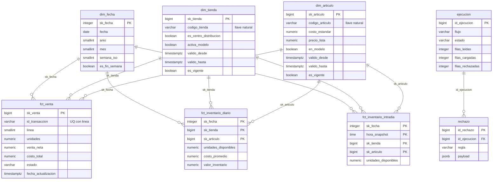

# Documentación de la base de datos

Motor: PostgreSQL 16 · DER editable: [`docs/modelo.dbml`](modelo.dbml) · DDL: [`sql/`](../sql)

> El modelo se entrega **incompleto a propósito**. Las secciones 1 a 4 (dimensional, raw, control de ETL) y la 5 (autenticación y autorización) están definidas e implementadas. Tu entregable de modelado son las **secciones 6** (instrucciones y su auditoría) y **7** (capa de consumo de los KPIs).

## 1. Capas

| Schema | Propósito | Estado |
|---|---|---|
| `raw` | Aterrizaje de las fuentes sin transformar (`payload` jsonb). Permite reprocesar sin volver al origen | Entregado |
| `core` | Modelo dimensional: dimensiones con historización y tablas de hechos | Entregado |
| `etl` | Control de ejecuciones, watermarks, rechazos y archivos procesados | Entregado |
| `app` | Entidades transaccionales: usuarios y permisos (entregados); instrucciones y su auditoría ⬜ a completar | Parcial |
| `analytics` | Capa de consumo de los KPIs | ⬜ **Vacía: su arquitectura es tu entregable** |

## 2. DER de lo entregado

## 3. Decisiones ya tomadas (y que puedes discutir)

| Decisión | Motivo |
|---|---|
| Modelo dimensional en estrella sobre el modelo normalizado | El consumo es analítico: KPIs agregados por mes, tienda y categoría |
| SCD tipo 2 en `dim_articulo` y `dim_tienda` | El costo estándar y la bandera `en_modelo` cambian en el tiempo y los KPIs históricos (margen, GMROI) deben calcularse con el valor vigente en su momento |
| `hash_atributos` en las dimensiones | Detectar cambios sin comparar columna por columna |
| Llave natural única en `fct_venta (id_transaccion, linea)` | Habilita el upsert de los cortes intradía, que son acumulados |
| `fct_inventario_diario` particionada por rango de `sk_fecha` | 1,080 combos x 365 días por año; el consumo casi siempre filtra por periodo |
| Separar `fct_inventario_intradia` de `fct_inventario_diario` | Distinto grano y distinta vida útil: el intradía es operativo y desechable, el diario es histórico |
| Capa `raw` con `payload` jsonb | Reprocesar sin depender de que el origen conserve el archivo |
| Índice único parcial `WHERE es_vigente` | Garantiza una sola versión vigente por llave natural |

Si consideras que alguna de estas decisiones es equivocada, cámbiala y defiéndela en `docs/MODELO.md`. No está prohibido; está sujeto a sustentación.

## 4. Diccionario de datos

### `core.dim_fecha`
Calendario. Grano: un día. Se puebla una vez con `sql/03_seed_dim_fecha.sql` (2022–2027).

| Columna | Tipo | Descripción |
|---|---|---|
| `sk_fecha` | `integer` PK | Llave con formato AAAAMMDD |
| `fecha` | `date` UQ | Fecha calendario |
| `anio`, `trimestre`, `mes`, `dia` | `smallint` | Partes de la fecha |
| `nombre_mes`, `nombre_dia` | `varchar` | Nombre en español |
| `dia_semana` | `smallint` | 1 = lunes … 7 = domingo |
| `semana_iso` | `smallint` | Semana ISO |
| `es_fin_semana` | `boolean` | Sábado o domingo |
| `primer_dia_mes`, `ultimo_dia_mes` | `date` | Bordes del mes, útiles para KPIs mensuales |

### `core.dim_articulo`
Artículos con historización SCD 2. Grano: una versión de artículo.

| Columna | Tipo | Descripción |
|---|---|---|
| `sk_articulo` | `bigserial` PK | Llave surrogada. Es la que referencian los hechos |
| `codigo_articulo` | `varchar(30)` | Llave natural del origen |
| `descripcion`, `codigo_categoria`, `categoria`, `subcategoria`, `marca`, `unidad_medida` | `varchar` | Atributos descriptivos |
| `costo_estandar`, `precio_lista` | `numeric(14,4)` | Versionados: cambian en el tiempo |
| `en_modelo` | `boolean` | Si el artículo participa en el modelo de inventario óptimo |
| `activo` | `boolean` | Si el artículo está vigente en el catálogo |
| `valido_desde` / `valido_hasta` | `timestamptz` | Ventana de vigencia de la versión. `NULL` en `valido_hasta` = vigente |
| `es_vigente` | `boolean` | Bandera de la versión actual. Índice único parcial |
| `hash_atributos` | `char(32)` | MD5 de las columnas versionadas |

### `core.dim_tienda`
Tiendas con historización SCD 2. Misma estructura de vigencia.

| Columna | Tipo | Descripción |
|---|---|---|
| `sk_tienda` | `bigserial` PK | Llave surrogada |
| `codigo_tienda` | `varchar(20)` | Llave natural |
| `nombre_tienda`, `departamento`, `region`, `formato` | `varchar` | Atributos descriptivos |
| `es_centro_distribucion` | `boolean` | Si la ubicación es CEDIS (origen habitual de las transferencias) |
| `activa_modelo` | `boolean` | Si la tienda participa en el modelo |
| `metros_cuadrados` | `integer` | Área de venta |
| `fecha_apertura` | `date` | Apertura de la tienda |
| `valido_desde`, `valido_hasta`, `es_vigente`, `hash_atributos` | | Control de versiones |

### `core.fct_venta`
Grano: una línea de transacción. Se actualiza 3 veces al día.

| Columna | Tipo | Descripción |
|---|---|---|
| `sk_venta` | `bigserial` PK | Llave técnica |
| `id_transaccion` + `linea` | `varchar` + `smallint` | Llave natural única. Base del upsert |
| `sk_fecha`, `sk_tienda`, `sk_articulo` | FK | Referencias dimensionales |
| `fecha_hora` | `timestamptz` | Momento de la venta en el origen |
| `unidades` | `numeric(14,3)` | Negativas cuando el estado es `DEVOLUCION` |
| `precio_unitario`, `descuento`, `costo_unitario` | `numeric` | Componentes del cálculo |
| `venta_neta` | `numeric(16,4)` | `unidades * precio_unitario - descuento` |
| `costo_total` | `numeric(16,4)` | `unidades * costo_unitario` |
| `estado` | `varchar(20)` | `CONFIRMADA` / `ANULADA` / `DEVOLUCION`. Restringido por CHECK |
| `canal` | `varchar(20)` | TIENDA / APP / DOMICILIO |
| `fecha_actualizacion` | `timestamptz` | Marca de cambio del origen. Define qué versión gana en el upsert |

### `core.fct_inventario_diario`
Grano: fecha × tienda × artículo. Snapshot de cierre. Particionada por año.

| Columna | Tipo | Descripción |
|---|---|---|
| `sk_fecha`, `sk_tienda`, `sk_articulo` | PK compuesta | Grano del snapshot |
| `unidades_disponibles` | `numeric(14,3)` | Existencia física disponible |
| `unidades_transito` | `numeric(14,3)` | En tránsito hacia la ubicación |
| `unidades_comprometidas` | `numeric(14,3)` | Reservadas y no disponibles para venta |
| `costo_promedio` | `numeric(14,4)` | Costo promedio de la existencia |
| `valor_inventario` | `numeric(16,4)` | `unidades_disponibles * costo_promedio` |
| `hora_snapshot` | `time` | Hora del snapshot que originó el cierre |

### `core.fct_inventario_intradia`
Grano: fecha × hora × tienda × artículo. Snapshot cada 30 minutos.

### `etl.ejecucion`, `etl.watermark`, `etl.rechazo`, `etl.archivo_procesado`
Control del ETL. Ver comentarios en `sql/02_ddl_core.sql`. `src/utils/run_tracker.py` ya implementa el acceso a estas tablas: el ETL debe usarlo.

## 5. Lo que falta definir (tu entregable)

| # | Sección del DBML | Qué debe soportar | Estado |
|---|---|---|---|
| 5 | Autenticación y autorización (`app`) | Usuarios con contraseña temporal forzada al primer ingreso, refresh tokens, y permisos por usuario × módulo × permiso | ✅ Entregado en `sql/05_ddl_app.sql` |
| 6 | Instrucciones y su auditoría (`app`) | Corridas del modelo, instrucciones (origen, destino, artículo, unidades, comentario, estado) y el registro de qué modificó cada usuario, sin perder la propuesta original | ⬜ **Tu entregable** |
| 7 | Capa de consumo de los KPIs (`analytics`) | Los 6 KPIs del módulo sobre un patrón de consumo interactivo y agregado | ⬜ **Tu entregable: la arquitectura es tuya** |

Los requisitos y el contexto de decisión de cada sección están detallados como comentarios en `docs/modelo.dbml`.
