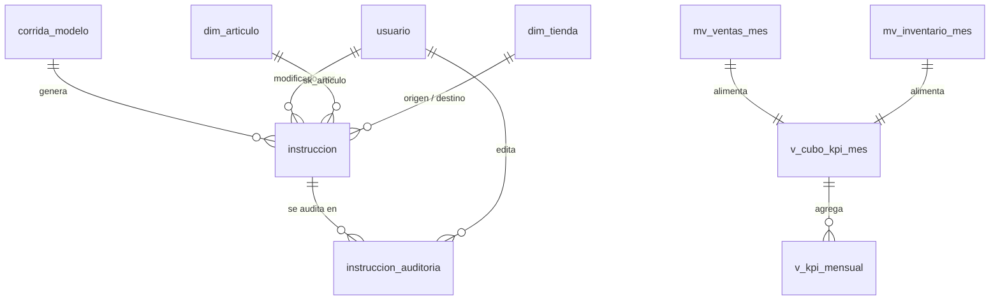

# Modelo de datos — secciones 6 y 7

> Plantilla a completar por el candidato. Las secciones 1 a 4 (dimensional, raw y control de ETL) y la 5 (autenticación y autorización) vienen entregadas. Aquí documentas lo que agregaste.

## 1. Instrucciones y su auditoría (sección 6)

### 1.1 Tablas que agregué

| Tabla | Grano | Llaves | Justificación |
| `app.corrida_modelo` | Una fila por ejecución periódica del modelo. `es_vigente` marca la corrida que muestra el módulo. |
| `app.instruccion` | (origen, destino, artículo, unidades, comentario). 
| `app.instruccion_auditoria` | Una fila por campo modificado: campo, valor anterior, valor nuevo, usuario (FK a `app.usuario`), fecha. |
| `app.v_instruccion_desviacion` |
| `app.v_instruccion_vigente` | Instrucciones de la corrida vigente. |

### 1.2 Decisiones

- **¿Auditoría por campo o por versión completa de la instrucción?** ¿Qué gana y qué pierde tu opción?
Elegí por campo: una fila en app.instruccion_auditoria por cada atributo modificado, con campo, valor anterior, valor nuevo, usuario y fecha.

- **¿Cómo conservas la propuesta original del modelo** cuando un humano edita la instrucción?
Un trigger rechaza cualquier UPDATE que cambie las columnas modelo, la corrida, el artículo o las tiendas. Así la propuesta no depende de reconstruir la bitácora. La desviación respecto al modelo es unidades - unidades_modelo, un cálculo directo. La vista app.v_instruccion_desviacion lo expone para el indicador de confianza. El costo es duplicar dos columnas.

- **¿Las instrucciones referencian la llave surrogada o la natural** de artículo y tienda? ¿Qué pasa cuando la dimensión versiona?
na llave natural no identificaría una fila única, y la instrucción no sabría a qué versión se refiere. La surrogada fija la versión vigente en el momento en que el modelo generó la instrucción, con su nombre, región y costo de entonces. Una instrucción de enero sigue apuntando a la versión de enero aunque en marzo el artículo cambie de costo.

- **¿Cómo garantizas una sola corrida vigente a la vez?**
Todas las filas con es_vigente = true se indexan con el mismo valor constante. Una segunda colisiona, así que la propia base de datos la rechaza aunque dos procesos compitan. Además hay un CHECK que solo permite que una corrida COMPLETADA sea vigente.

- **¿Qué restricciones pusiste a nivel de base de datos** (estados válidos, origen distinto de destino, unidades positivas) y qué dejaste a la aplicación?
La base de datos garantiza lo que es estructural y no depende de datos que cambian. Las reglas de negocio cambian con frecuencia y requieren datos de otros dominios, y por eso viven en la aplicación. La consecuencia es que una instrucción hacia una tienda inactiva no la frena la base.


### 1.3 Consulta de comprobación

```sql
-- ¿Cuáles instrucciones fueron alteradas por un humano el mes pasado
-- y en qué magnitud respecto a lo que propuso el modelo?
```
SELECT * FROM app.v_instruccion_desviacion
 WHERE modificado_en >= date_trunc('month', now()) - interval '1 month'
   AND modificado_en <  date_trunc('month', now())
 ORDER BY desviacion_relativa DESC;

## 2. Capa de consumo de KPIs (sección 7)

### 2.1 Arquitectura propuesta

Qué estructura elegiste para la capa `analytics`, con qué granos, y **por qué es la adecuada para el patrón de consumo del dashboard**. Este es el punto que más pesa del apartado: se evalúa el argumento, no la cantidad de objetos.

| Objeto | Tipo | Grano | KPIs que resuelve | Cómo se actualiza |
| `mv_ventas_mes` | Vista materializada | mes × tienda × artículo (por código) | Ventas, margen, rotación (numerador), GMROI (numerador) | `REFRESH ... CONCURRENTLY` tras cada corte de ventas |
| `mv_inventario_mes` | Vista materializada | mes × tienda × artículo | Costo de inventario, rotación y GMROI (denominador), stockouts | `REFRESH ... CONCURRENTLY` tras el cierre diario |
| `v_dim_articulo_actual`, `v_dim_tienda_actual` | Vista | 1 fila por **código** | Atributos de filtro (región, formato, categoría, subcategoría) | Siempre actual (lee la versión vigente) |
| `v_cubo_kpi_mes` | Vista | mes × tienda × artículo | Une ambas MV + atributos | Siempre actual |
| `v_kpi_mensual` | Vista | mes × región × formato × categoría × subcategoría | Los 6 KPIs | Siempre actual |

### 2.2 Alternativas que descarté

| Alternativa | Por qué no |
Una tabla final con razones precalculadas (región × categoría × mes) | Las razones no se agregan; habría que precalcular todas las combinaciones de filtros o responder mal. 

### 2.3 Costos de mi propuesta

Qué se vuelve más difícil o más caro con la estructura que elegiste: almacenamiento, latencia del dato, complejidad del ETL, mantenimiento.

**Latencia del dato:** las ventas llegan al KPI al terminar cada refresco (3/día); el inventario, tras el cierre (1/día). El inventario intradía no entra en los KPIs mensuales. Aceptable para un KPI mensual; no para un tablero operativo.

**Refresco completo:** cada refresco recalcula todo el histórico (segundos con este volumen). Con más volumen habría que pasar a refresco incremental por mes abierto.
## 3. Cambios al modelo entregado

Si modificaste algo de las secciones 1 a 5, documéntalo aquí.

| # | Cambio | Motivo |
|---|---|---|

## 4. DER de lo que agregué


