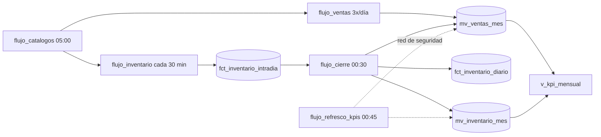

# Estrategia de orquestación

> Plantilla a completar por el candidato. Esta prueba exige la estrategia **implementada y ejecutable**, no solo documentada.

## 1. Herramienta seleccionada

**Elección:**
Con `orchestration/prefect.yaml` y `docker-compose.prefect.yml`

**Justificación:**
Se utilizó docker-compose.prefect.yml porque ya viene preconfigurado el servidor con Prefect que ya viene en los requerimientos.

| Herramienta | Ventajas | Desventajas | Por qué (no) la elegí |
|Prefect 3|BD lista|Menos usado en grandes empresas|Elegida|
| | | | |

## 2. Diseño de los flujos


| Flujo | Frecuencia | Ventana | Depende de | Reintentos | Timeout | Acción ante fallo |
|---|---|---|---|---|---|---|
| Catálogos (dimensiones) | Diario 05:00 | Antes del primer corte |ya implementado | — | Alerta; los hechos se bloquean |
| Ventas intradía (3 cortes) | 08:10, 14:10, 20:10 | 10 min tras el corte, para que el archivo aterrice | Catálogos en EXITO < 30 h | 3, cada 5 min | 30 min | Alerta; el siguiente corte lo cubre (acumulado) |
| Inventario intradía (30 min) | min 2 y 32, 06:00–23:30 | Cada media hora | Catálogos en EXITO < 30 h | 2, 30 s; no para `SnapshotIncompleto` | 20 min | Alerta; se espera al siguiente snapshot |
| Cierre diario de inventario | 00:30 | Tras el snapshot de las 23:30 | Sin snapshot| Reintento de la ejecución | — | Alerta; es idempotente, se relanza a mano |
| Refresco de objetos de KPIs | En ventas, en el cierre (ambas) y 00:45 diario | — | — | 2, 60 s | — | Alerta; el dato anterior sigue disponible |
| Cargas históricas | Una vez | — | — | — | — | Fuera del schedule (CLI) |

### 2.1 Diagrama



## 3. Preguntas que la estrategia debe responder

- **Concurrencia:** el snapshot de las 08:00 empieza mientras el de las 07:30 aún corre. ¿Qué pasa?
cada despliegue tiene concurrency_limit: 1 con collision_strategy: ENQUEUE: el de las 08:00 espera en cola y no se pierde ni se cancela. Además es seguro aun sin el límite: el SnapshotLoader sólo reemplaza su alcance (sk_fecha, hora_snapshot) y los alcances de dos snapshots son disjuntos, así que no se pisan. El timeout (20 min) es menor que el intervalo (30 min) para que una corrida colgada no acumule cola. El límite protege la BD y preserva el orden.

- **Solapamiento de cortes:** los cortes de ventas son acumulados. ¿Cómo evitas duplicar o perder ventas?
El UpsertLoader usa ON CONFLICT (id_transaccion, linea) DO UPDATE ... WHERE existente.fecha_actualizacion <= entrante.fecha_actualizacion AND (cols) IS DISTINCT FROM (...).

- **Fallo aislado:** el snapshot de las 07:30 falla. ¿Se detiene la cadena, se salta, se reintenta? ¿El cierre diario puede correr con un snapshot faltante?
El snapshot de las 07:30 llega incompleto y se descarta entero (SnapshotIncompleto, ejecución FALLIDA, alerta, sin reintentos porque reintentar no completa un archivo). La cadena no se detiene: el de las 08:00 es independiente. El cierre sí puede correr con ese snapshot ausente porque usa el último snapshot válido del día; sólo falla si no existe ninguno (error explícito, no un cierre vacío).


- **Ventas tardías:** llegan ventas con fecha del día anterior. ¿Reprocesas el día anterior? ¿Automáticamente o a mano?
No hay reproceso manual: el refresco de la MV de ventas del mismo flujo lo recoge automáticamente.

- **Backfill:** cómo reprocesar un día o un rango, y por qué es seguro hacerlo.
Reprocesar es seguro porque el upsert no duplica y el snapshot/cierre reemplazan su alcance.

- **Alertamiento:** qué se notifica, a quién y con qué umbral (por ejemplo, ratio de rechazo sobre el máximo configurado).
Todos los flujos tienen alerta, fallo tras agotar reintentos, snapshot incompleto, catálogos desactualizados (> 30 h) y cierre sin snapshots.

- **Dependencia con las dimensiones:** un artículo nuevo aparece en una venta antes de estar en el catálogo. ¿Qué hace el flujo?
Bloquea ventas e inventario si dim_articulo no tuvieron una ejecución EXITO en las últimas 30 h.

## 4. Cómo ejecutarlo

Comandos exactos para levantar el orquestador, registrar los flujos y disparar un backfill.

```bash
docker compose -f docker-compose.yml -f docker-compose.prefect.yml up -d
# registrar TODOS los despliegues (el yaml está en orchestration/)
docker compose -f docker-compose.yml -f docker-compose.prefect.yml \
    exec prefect-worker prefect deploy --all --prefect-file orchestration/prefect.yaml
# UI en http://localhost:4200

# Backfill de un día
prefect deployment run 'etl-ventas-intradia/ventas-0800' \
    -p fecha=2026-03-02 -p corte=0800 -p validar_catalogos=false
prefect deployment run 'etl-inventario-intradia/inventario-intradia' \
    -p fecha=2026-03-02 -p hora=0630 -p validar_catalogos=false
prefect deployment run 'etl-cierre-diario/cierre-diario' -p fecha=2026-03-02

# Sin orquestador (mismo código)
python main.py ventas-intradia --fecha 2026-03-02 --corte 1400
python main.py refrescar-kpis
```
